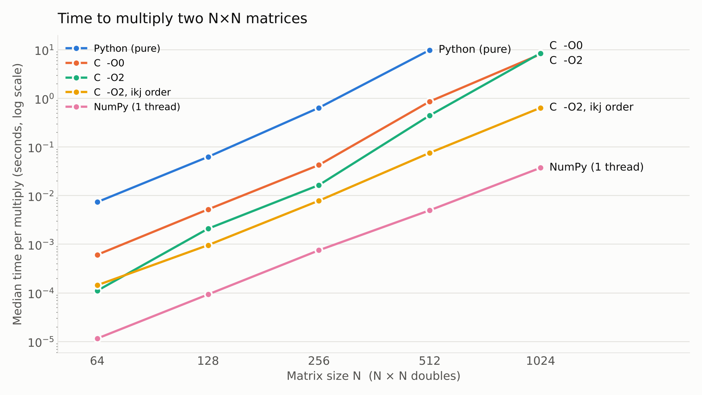
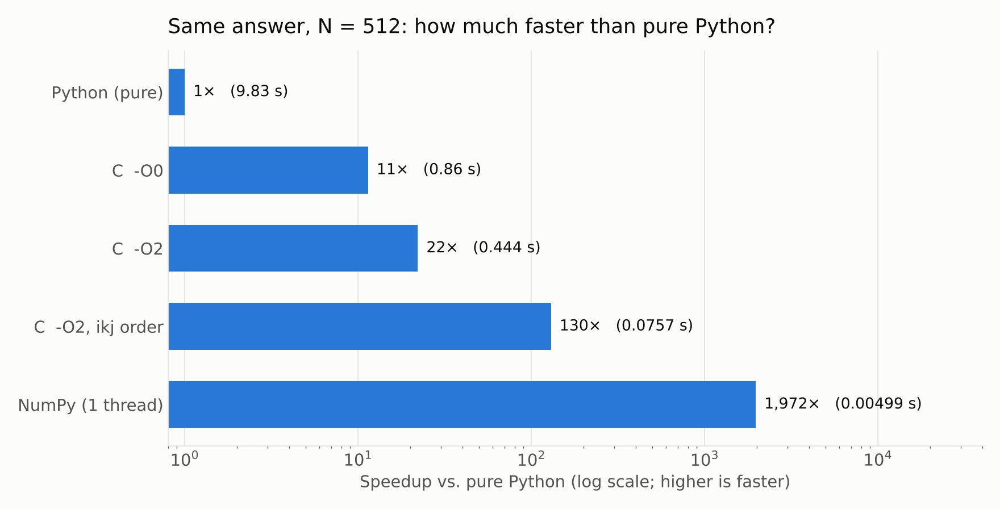
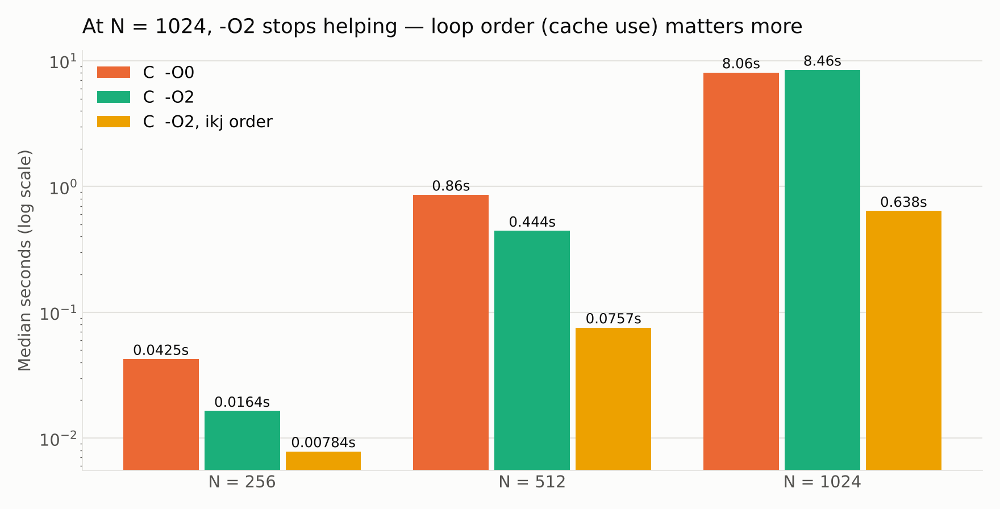
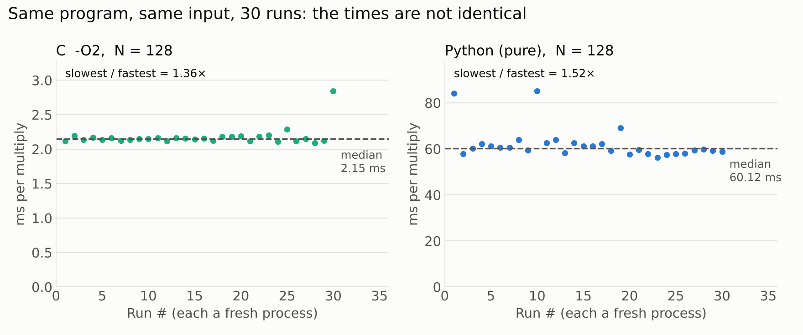

# Benchmarking C vs. Python: Matrix Multiplication

**COMP 211 Final Checkoff — AI-Guided Exploration** · Gokul Kannan · UNC Chapel Hill · Fall 2026

> "Is C faster than Python?" sounds like a yes/no question. While learning how to
> benchmark properly, I found the more interesting answer: *it depends on what you
> measure, how you measure it, and what the code does with memory.*

## What I explored

My subtopic was **performance benchmarking**: how to design a benchmark you can trust,
measure execution time correctly, and interpret the results. To practice, I wrote the
**same naive matrix-multiplication algorithm** (the textbook triple loop) in C and Python
and benchmarked five versions on matrices from 64×64 to 1024×1024:

| Version | What it is |
|---|---|
| `py_pure` | Python lists of lists, triple loop |
| `c_O0` | Same algorithm in C, compiled with `gcc -O0` (no optimization) |
| `c_O2` | Same C code, `gcc -O2` |
| `c_O2_ikj` | Same C code with loops reordered i‑k‑j (cache-friendly) |
| `py_numpy` | Python calling NumPy's `A @ B` (optimized BLAS library), 1 thread |

Every version is checked to produce the **same checksum**, so they are doing the same math.

## Most interesting discoveries

1. **C was 11×–66× faster than pure Python** for the *same* algorithm (11–15× at `-O0`, 22–66× at `-O2`, depending on N).
   Python pays for every `+` and `*` through the interpreter: type checks, boxed float
   objects, and reference counting.
2. **NumPy, called from Python, was ~2,000× faster than pure Python and ~89× faster than my
   `-O2` C code.** "Python vs. C" is really "interpreted loop vs. compiled loop vs. a library
   someone spent decades tuning." NumPy's speed comes from C/assembly underneath.
3. **The biggest surprise (and the COMP 211 connection): at N = 1024, `-O2` was *no faster*
   than `-O0` (8.46 s vs 8.06 s).** The CPU spends its time waiting on memory. In i‑j‑k order the inner
   loop walks *down a column* of B, jumping 1024 × 8 bytes = 8 KB each step, so almost every
   access misses in cache. Just **swapping two loops (i‑k‑j)** makes the inner loop walk
   across a row (stride 1), which made it **13× faster** with no other change. Memory
   locality mattered more than the compiler optimizations.
4. **A benchmark can lie if the result isn't used.** In `dce_demo.c`, `-O2` deletes a loop
   whose result is never used, so a 0.24 s loop "runs" in 0.000001 s. That's why every program prints a checksum.
5. **One run isn't enough.** The same program on the same input varied by up to **1.36×
   (C) and 1.52× (Python)** across 30 runs. I report the **median** of many runs.





## Answers to the investigation questions

### 1. How can you measure the execution time of a program?
- **Whole-process wall time** from the shell: `time ./matmul_O2 512 1`. It's easy, but it includes
  process startup, loading, and any setup work. `real` = wall clock; `user`/`sys` = CPU time
  spent in user mode / the kernel.
- **Timing inside the program** around only the code you care about:
  - C: `clock_gettime(CLOCK_MONOTONIC, ...)` gives nanosecond resolution and never jumps backward.
    (`time()` only has 1-second resolution; `clock()` measures CPU time, not wall time.)
  - Python: `time.perf_counter()`, the highest-resolution monotonic clock.
    (`time.time()` can jump if the system clock is adjusted.)
- I used in-program timing so startup and initialization aren't counted.

### 2. What tools can you use to benchmark C and Python programs?
| Tool | Language | What it does |
|---|---|---|
| `time` (shell) | any | Whole-process real/user/sys time |
| `clock_gettime` | C | High-resolution timer inside the program |
| `time.perf_counter` | Python | High-resolution timer inside the program |
| `timeit` | Python | Runs a snippet many times, avoids common pitfalls |
| `pyperf` | Python | Rigorous benchmarking: spawns workers, calibrates loops, reports std dev |
| `hyperfine` | any | Command-line benchmarking: warm-ups, many runs, mean ± σ, outlier warnings |
| `perf stat` (Linux) | any | Hardware counters: cycles, instructions, **cache misses** |
| `cProfile` / `gprof` | Py / C | *Profilers*: show **where** time goes (not the same as benchmarking) |

### 3. Why is it important to run a benchmark multiple times?
Because the measurement is noisy. The OS schedules other processes, the CPU changes clock
speed (frequency scaling / turbo), and caches can be warm or cold. My 30-run experiment
showed a 1.36×–1.52× spread between the fastest and slowest runs of an *identical*
program. With one run you can't tell a real difference from noise. Repeating lets you
report a **typical value (median)** and the **spread (std dev / coefficient of variation)**.



### 4. What factors can influence benchmark results?
- **Compiler optimization level** (`-O0` vs `-O2`): 1.9–5.5× faster at `-O2` for N ≤ 512 in my tests (and *no* gain at N = 1024).
- **Memory access pattern / cache behavior**: 13× difference at N = 1024 from loop order alone.
- **Input size**: the C (-O2) / Python ratio was 66× at N = 64, 30× at 128, 39× at 256 and 22× at 512, so one size doesn't tell the whole story.
- **Startup overhead**: starting a C program took ~1.1 ms, Python ~12.8 ms, Python + `import numpy` ~88 ms.
  For tiny inputs, whole-process timing would mostly measure startup.
- **Dead-code elimination**: the compiler can delete work whose result is unused.
- **Warm-up**: first runs can be slower (page faults, cold caches, JIT compilers). I tested this for pure Python: the
  first run was only ~2% slower, because standard CPython 3.13 doesn't JIT by default. It's still good practice to warm up.
- **Threads**: NumPy's BLAS can use multiple cores. I pinned it to 1 thread for a fair comparison.
- **Background load, CPU frequency, hardware**: results from my machine won't match yours exactly.

### 5. How can you ensure that you're making a fair comparison?
- Same **algorithm**, same **data**, same **amount of work**, verified with a **checksum**.
- Time **only the work** (exclude startup, allocation, input generation) or explicitly report both.
- Same **machine**, same conditions, interleaved/back-to-back runs.
- State the **compiler flags** and **library/thread settings** (an `-O0` vs. Python comparison isn't the same claim as `-O2` vs. Python).
- Don't compare a naive algorithm in one language to a tuned library in the other *and call it a
  language comparison*. That's why NumPy is its own separate row.

### 6. How should you interpret and report your results?
- Report the **median** (or min) plus a measure of spread, the **number of runs**, and the **environment**
  (CPU, compiler + flags, Python/NumPy versions). See `results/environment.txt`.
- Use **log scales** when values span orders of magnitude, and report **ratios** (speedups) alongside raw times.
- Show results **across several input sizes**, since the ratio between versions isn't constant.
- Explain *why* (interpreter overhead, cache misses) instead of only *what*, and say what the results do **not** show
  (e.g., this is one algorithm on one machine).

## Repository layout
```
.
├── README.md               ← you are here
├── REFLECTION.md           ← written reflection on how I used AI
├── ai-conversation.md      ← my AI exploration dialogue
├── RESOURCES.md            ← references I consulted
├── Makefile
├── requirements.txt
├── src/
│   ├── matmul.c            ← C benchmark (ijk + ikj loop orders)
│   ├── matmul.py           ← Python benchmark (pure + NumPy)
│   ├── bench.py            ← harness: compiles, runs all configs, writes CSV
│   ├── experiments.py      ← startup cost, run-to-run noise, warm-up
│   ├── dce_demo.c          ← dead-code-elimination demo
│   └── plot.py             ← makes the charts
├── results/                ← CSVs, charts, environment.txt
└── slides/                 ← presentation slides (PDF)
```

## How to run it
Requirements: `gcc`, Python 3.10+, and `pip install -r requirements.txt` (numpy, matplotlib). Linux or macOS.

```bash
make                     # compile the C programs (-O0, -O2, dce_demo)

# run a single benchmark by hand: <N> <reps> [variant]
./src/matmul_O2 256 5          # C, textbook ijk order
./src/matmul_O2 256 5 ikj      # C, cache-friendly order
python3 src/matmul.py 256 5           # pure Python
python3 src/matmul.py 256 5 numpy     # NumPy
# each line printed = <seconds> <checksum>; checksums should all match

make quick               # ~30 s smoke test of the whole suite
make bench               # full suite, ~4-5 min -> results/results.csv
make experiments         # startup / noise / warm-up experiments
make plots               # regenerate charts in results/
make dce                 # dead-code-elimination demo
```

## My results (median of 10 runs; 5 for pure Python at N = 512)
Machine: Intel Xeon @ 2.10 GHz (2 cores), Linux, gcc 13.3, Python 3.13, NumPy 2.5 (1 thread).

| N | Python (pure) | C -O0 | C -O2 | C -O2 ikj | NumPy |
|---:|---:|---:|---:|---:|---:|
| 64 | 7.35 ms | 0.61 ms | 0.11 ms | 0.14 ms | 0.012 ms |
| 128 | 62.4 ms | 5.20 ms | 2.09 ms | 0.96 ms | 0.093 ms |
| 256 | 638 ms | 42.5 ms | 16.4 ms | 7.84 ms | 0.75 ms |
| 512 | 9.83 s | 0.860 s | 0.444 s | 0.0757 s | 0.0050 s |
| 1024 | (skipped, ~80 s) | 8.06 s | 8.46 s | 0.638 s | 0.0373 s |

Raw data: [`results/results.csv`](results/results.csv). Your numbers will differ by machine, but the patterns should hold.

## Limitations
- One algorithm (naive O(N³) matmul) on one machine. Other workloads (string processing, I/O) could show very different ratios.
- Pure Python at N = 1024 was skipped (~80 s per run).
- Times under ~0.1 ms (NumPy at N = 64) are near timer/noise limits; that's why its spread is larger.
- I didn't control CPU frequency scaling or pin to a core (tools like `pyperf system tune` can do this).
